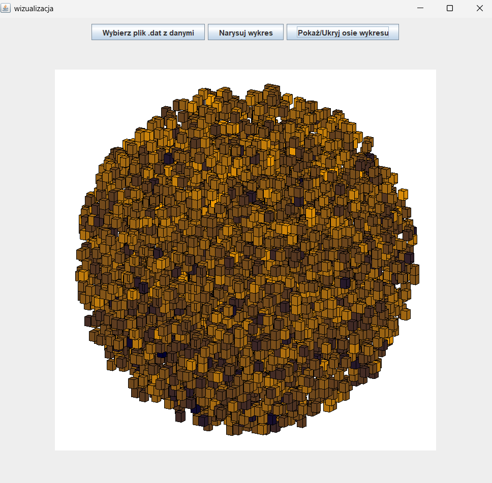

# 3D Cell Data Visualization

A Java application for visualizing 3D cell structures. The input data contains the coordinates and relative age of individual cells, which are represented as cubes in an interactive 3D visualization.

## Features

- 3D visualization of cell coordinates as individual cubes
- .dat file selection for loading input data
- Optional visualization of relative cell age
- Color mapping from bright yellow for younger cells to black for older cells
- Interactive 3D rotation and movement using the mouse
- Show/hide controls for the coordinate axes
- An experimental culling version

## Input Data

The application reads .dat files containing four values for each cell:

- X coordinate
- Y coordinate
- Z coordinate
- Relative cell age

The data was provided as output from a cancer cell simulation.

## Visualization Versions

The project contains three visualization implementations:

### Version 1

Visualizes the cell coordinates without using cell age.

### Version 2

Adds cell age to the visualization using a color gradient. Younger cells are displayed in bright yellow, while older cells are displayed in black.

### Version 3

Extends the age-based visualization with an experimental culling implementation intended to reduce the amount of geometry that needs to be rendered.

## Interaction

The 3D structure can be rotated and moved using the mouse.

The application provides three interface buttons:

- **Narysuj wykres** — render the visualization
- **Wybierz plik .dat z danymi** — select an input `.dat` file
- **Pokaż/Ukryj osie wykresu** — show/hide the coordinate axes

## Implementation

The visualization is implemented in Java using the JZY3D library. Each cell
is represented as an individual cube in the 3D scene.

The project contains three separate application entry points, corresponding to the three visualization versions. The `UniformChartMouseController` class is shared between all three versions and provides common mouse interaction functionality.

Swing and AWT are used for the application interface and supporting functionality.

## Performance

The initial visualization approach was sufficient for the datasets provided
for the project and could be run on a standard computer.

Since each cell is represented as a separate rendered cube, the approach becomes increasingly expensive as the number of cells grows. Larger structures can therefore cause noticeable performance degradation.

The third version experiments with culling as an alternative approach to reduce the rendering workload.

## Technologies

- Java
- JZY3D
- Swing
- AWT

## Project Context

The project was developed independently from a set of cancer cell simulation data provided by a professor.

The task was to create a 3D visualization based on the provided data and an example of the desired visual representation.

## Example Data

An example dataset is included in example_data/example_cells_5000.dat.

The dataset contains 5,000 cells and is provided for testing and demonstrating the visualization without sharing the original simulation data.

## Status

Complete.
